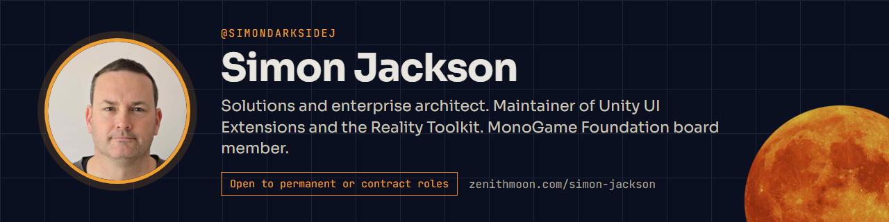

 
&ensp; 
&ensp;
&ensp; 
&ensp; 
&ensp;

<table><tr><td valign="top" width="75%">

## 👋 Hi, I am Simon "Darkside" Jackson

I am a solutions and enterprise architect with more than 30 years in software. I started in healthcare integration, then added games, XR, web and applied AI. I design the system and I also build it.

The full profile, with work history and recommendations, is on [zenithmoon.com/simon-jackson](https://zenithmoon.com/simon-jackson). I am open to permanent or contract roles.

### What I do now

- I am the CTO and Chief Architect at [Ethar](https://www.ethar.com/), under contract through ZenithMoon Studios. The work covers XR products, including a location-based AR guide.

- I am a board member at the [MonoGame Foundation](https://www.monogame.net/). MonoGame is an open source framework that continues Microsoft's XNA and ships games to all current platforms. I organise the monthly MonoGame Open Hours sessions, develop for the framework and help produce its education content.

    

### Open source

- I build and maintain the [Reality Toolkit](https://realitycollective.io/), a cross-platform Mixed Reality framework for XR apps in Unity. It supports Quest, Pico, HoloLens, Magic Leap, mobile and more. It grew from the foundation I co-created for Microsoft's [Mixed Reality Toolkit v2](https://github.com/microsoft/MixedRealityToolkit-Unity/tree/releases/2.8.3), which became the [XRTK](https://github.com/xrtk) and then the [Reality Collective](https://realitycollective.io/).

    

- I maintain and publish the [Service Framework](https://service-framework.realitycollective.io/), part of the Reality Collective. It gives Unity projects a service-based structure.

- I publish and maintain the [Unity UI Extensions](https://github.com/unity-UI-Extensions/com.unity.uiextensions) project, a collection of community-built Unity UI components and utilities.

- The public project I am most proud of is [Project Fizzyo](https://www.microsoft.com/en-us/research/project/project-fizzyo/). It built games and a game framework that turn Cystic Fibrosis physiotherapy into play for children.

### Books

- I am the author of three technical books: [Mastering Unity 2D Game Development](https://www.amazon.co.uk/Mastering-Unity-2D-Game-Development/dp/1849697345), [Unity UI Essentials](https://www.amazon.co.uk/gp/product/B00T96XBYI) and [Accelerating Unity Through Automation](https://link.springer.com/book/10.1007/978-1-4842-9508-3).

            

- I write on my [DarkGenesis blog](https://darkgenesis.zenithmoon.com/) about game development, automation and other technology.

### Recognition

- I was a [Microsoft MVP](https://mvp.microsoft.com/en-us/PublicProfile/5001069?fullName=Simon%20Jackson) (Most Valuable Professional) for 13 consecutive years.

    

- I have been a [Microsoft Game Development Ambassador](https://developer.microsoft.com/en-us/games/community/ambassadors/) since the programme launched in 2021, helping developers with the Microsoft game development stack.

- I was an Xbox MVP for several years, helping developers publish to Xbox and Windows. That programme merged into the [Xbox Ambassadors programme](https://news.xbox.com/en-us/2020/09/25/who-are-xbox-ambassadors/), where I still work with the Xbox team.

    

</td><td valign="top" width="25%">

## 🖥️ What I work with

- Solution and enterprise architecture
- Enterprise integration
- Cloud and applied AI
- C#
- Unity
- MonoGame
- Mixed Reality (AR/VR/XR)
- Game development
- Xbox development / ID@Xbox
- AI tooling and production
- Asset development
- Unreal (in progress)

</td></tr></table>

&ensp;&ensp;

<table><tr><td valign="top" width="50%">

##    My YouTube channels

<!-- YOUTUBE-VIDEOS-LIST:START -->
- [Unity UI Extensions](https://www.youtube.com/@UnityUIExtensions) - the channel for the Unity UI Extensions project.
- [The Darkside of MonoGame](https://www.youtube.com/@DarksideofMonoGame) - MonoGame helper videos, tutorials and demos.
- [The Darkside of VR](https://www.youtube.com/@DarksideofVR) - support channel for the Microsoft Mixed Reality Toolkit (no longer updated).
- [SimonDarksideJ](https://www.youtube.com/@SimonDarksideJ) - my personal channel.
<!-- YOUTUBE-VIDEOS-LIST:END -->

</td><td valign="top" width="50%">

##    DarkGenesis blog posts

<!-- DEVTO-BLOG-LIST:START -->
- [The Automation series](https://darkgenesis.zenithmoon.com/tag.html?tag=automation) - getting to grips with GitHub Actions and Azure Pipelines.
- [Creating your own blog on GitHub Pages](https://darkgenesis.zenithmoon.com/tag.html?tag=jekyll) - how to build your own free blog on GitHub.
- [All the MonoGame content](https://darkgenesis.zenithmoon.com/tag.html?tag=monogame) - MonoGame guides and tutorials.
- [All the Unity posts](https://darkgenesis.zenithmoon.com/tag.html?tag=unity3d) - Unity guides and tutorials.
<!-- DEVTO-BLOG-LIST:END -->

</td></tr></table>
